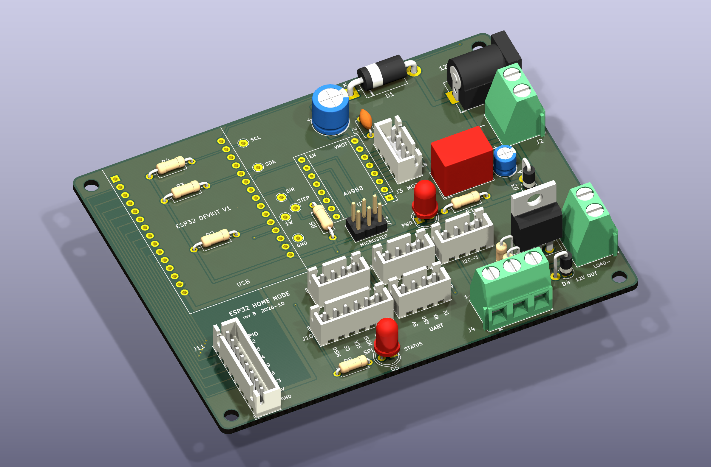

# esp32-home-automation
Project to make my home smart using several ESP32 MCUs, sensors, and motors.

## Layout
- [temperature-control](temperature-control): temperature and humidity monitoring, thermostat motor control
- [security-camera](security-camera): camera node publishing frames over MQTT
- [hardware/esp32_carrier_board](hardware/esp32_carrier_board): carrier PCB for the DevKit

All nodes talk MQTT to the broker on the Raspberry Pi and are built with ESP-IDF.

## Main Components
This Smart Home system has the following features:
- Temperature Monitoring
- Temperature Control
- Humidity Monitoring
- Security Camera

### Temperature Monitoring
Temperature is monitored using a DS18B20 sensor, which uses the 1-Wire protocol to communicate with an ESP32.

### Temperature Control
Temperature is controlled using a NEMA17 motor. In order to prevent step loss, and ensure the motor sets the switch to the target temperature, a magnetic encoder is used.

### Humidity Monitoring
Humidity is monitored using an SHT31 sensor, which uses I2C to communicate with ESP32

## Hardware
The ESP32 home node carrier board (KiCad project, Gerbers, BOM, renders) is in [hardware/esp32_carrier_board](hardware/esp32_carrier_board).

Top and bottom views: [render_top.png](hardware/esp32_carrier_board/fab/render_top.png), [render_bottom.png](hardware/esp32_carrier_board/fab/render_bottom.png).
